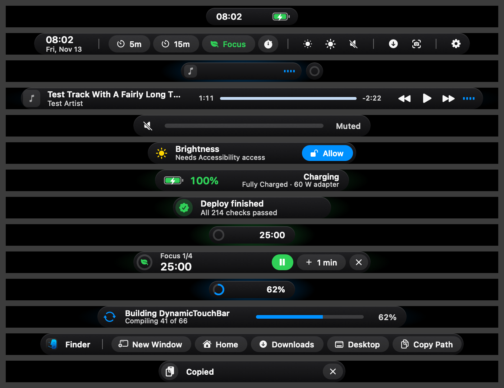

# DynamicTouchBar

A Dynamic Island–style interface for the **physical Touch Bar** on Touch Bar MacBook Pros, built with
Swift, AppKit, Core Animation and SwiftUI. Everything uses public APIs, except the opt-in **Always-on mode**
(see below), which is isolated in one file.



*Rendered by the app's own `IslandView` at the real 685 × 30 pt Touch Bar app region (produced by the test
suite; not photos of the hardware).*

---

## Requirements

| | |
|---|---|
| macOS | 14 Sonoma or later (developed on macOS 26.3) |
| Xcode | 16 or later (developed with Xcode 26.6) |
| Hardware | Any Touch Bar MacBook Pro — e.g. 13-inch M1 (`MacBookPro17,1`), 13-inch M2 (`Mac14,7`), 2016–2020 Intel models |

> The 14-/16-inch M1 Pro/Max and M2 Pro/Max MacBook Pros have **no** Touch Bar. On Macs without one
> the app runs as a preview (on-screen mirror + Settings preview) and says so.

## Build & install

```bash
xcodebuild -project DynamicTouchBar.xcodeproj -scheme DynamicTouchBar -configuration Release -derivedDataPath build/DerivedData build
```

```bash
cp -R build/DerivedData/Build/Products/Release/DynamicTouchBar.app /Applications/
```

```bash
open /Applications/DynamicTouchBar.app
```

Or open `DynamicTouchBar.xcodeproj` in Xcode and press Run. The app is ad-hoc signed, so macOS
privacy permissions (Automation, Accessibility) are tied to that build. After rebuilding,
macOS may ask again.

**Touch Bar setting:** System Settings ▸ Keyboard ▸ Touch Bar Settings ▸ *Touch Bar shows* must be **App Controls**
(the default). With *Expanded Control Strip* macOS hides all app controls.

Keep only **one** copy registered. If a Debug and a Release build are both around, the second one to launch quits itself.

## Using it

| Action | How |
|---|---|
| Bring the island to the Touch Bar | **⌃⌥Space** (configurable), or menu bar icon ▸ *Show on Touch Bar* |
| Go back to your app | Press the shortcut again, tap **esc**, or click into another app |
| Expand / collapse | Tap the capsule |
| Swap live activities | Tap the small bubble beside the capsule |
| Settings | Menu bar icon ▸ *Settings…* (the Touch Bar shows the island while Settings is open) |

### States

Minimal · Expanded dashboard · Music (compact / expanded) · Notification · Battery · Volume · Brightness ·
Timer (compact / expanded) · Progress (compact / expanded) · Contextual app actions · Clipboard (opt-in).
When two live activities run, the second one appears as a detached bubble.

## The one big platform limitation

**macOS only shows the Touch Bar of the frontmost app.** There is no public API that puts a third-party
Touch Bar on top of other apps. Tools that do so (e.g. "always-on" Touch Bar utilities) call the private
`DFRFoundation` system-modal APIs, which this project deliberately does not use.

By default DynamicTouchBar therefore works like a summoned overlay. The shortcut activates it and the island appears
on the physical Touch Bar. Dismissing it hands focus straight back to the app you came from. Verified on a
13-inch M1: the island item is created and laid out at exactly **685 × 30 pt** (the app region next to the
collapsed Control Strip). With the Control Strip hidden the layout adapts automatically, because the island
sizes itself from the width the Touch Bar reports.

### Always-on mode (opt-in, experimental)

Settings ▸ General ▸ **Always-on mode**. While idle, your normal Touch Bar stays untouched and a small island
button sits in the Control Strip. When something happens (music starts or the track changes, a notification,
a finished timer, the charger, a copy) the island rises over the current app for a few seconds, then minimises.
Touching it keeps it up, and tapping the Control Strip button brings it up on demand. Volume changes don't make
it rise by default, so it never covers the system volume slider while you drag it.

This mode uses the **private** system-modal Touch Bar API (`NSTouchBar presentSystemModalTouchBar…`,
`DFRFoundation`), the same mechanism Pock and MTMR use. It lives entirely in
`Integrations/SystemTouchBarBridge.swift`. Every symbol is looked up at runtime, nothing is linked, and if a macOS
update removes it the toggle disables itself and the app falls back to shortcut mode. It injects nothing into
other apps.

**Verified on macOS 26.3 / 13-inch M1:** with Safari frontmost the island rose (685 × 30 pt next to the Control
Strip; 1004 pt with *Cover the Control Strip*) and minimised again on its own. **Not verified:** the Control Strip
button's appearance and taps (no screen capture of the Touch Bar was possible here).

## Feature notes & honest limits

| Module | How it works | Limits |
|---|---|---|
| **Music** | Music.app & Spotify via their public distributed notifications (event-driven) and AppleScript dictionaries. The playhead is extrapolated locally and re-synced every 10 s only while the expanded player is visible. Artwork is cached (NSCache). | Other players (browsers etc.) publish state only through the private MediaRemote framework, so no track info is shown for them. Optional media keys can still play/pause them (needs Accessibility). The waveform is an animated *activity indicator*, not an audio analyser; real audio would need Screen Recording permission. |
| **Volume** | CoreAudio HAL property listeners for volume, mute and default-device changes. Slider sets the volume. | Some outputs (HDMI, certain USB) have no software volume; the island says so. |
| **Brightness** | Steps brightness by posting the standard brightness-key events. | **No public API can read or set built-in display brightness on Apple Silicon.** No level meter is drawn because it would be fabricated; macOS shows its own HUD. Needs Accessibility. *Not verified on hardware in development (see Testing).* |
| **Battery** | `IOPSNotificationCreateRunLoopSource`. Charging shimmer, low battery warning, fully-charged event, adapter wattage, Low Power Mode. | — |
| **Notifications** | The app's own events (timer, battery, media, progress, clipboard) plus anything sent to `dynamictouchbar://notify`. Notifications that arrive while hidden are held (max 3, 5 min). | Other apps' notifications are private to macOS and never read. |
| **Clipboard** | **Off by default.** Checks the integer `changeCount` about once a second while enabled (macOS has no change notification). Skips password managers and concealed or transient types. Hides strings that look like secrets. Memory only, dropped after 60 s. | macOS may show its own "paste from other apps" privacy prompt. |
| **Timer & Focus** | Countdown, stopwatch, Pomodoro, focus. Wall-clock based, so it stays exact while collapsed and across sleep. Optional sound and Notification Center alert. | — |
| **Progress** | `dynamictouchbar://progress` for scripts, Xcode Behaviors and Shortcuts, plus an opt-in Downloads-folder watcher (kqueue, event-driven). | Browsers don't expose download percentages, so downloads show as in progress with the bytes received. |
| **Context** | `NSWorkspace` activation notifications track the app you came from. Per-app profiles run actions through that app's scripting dictionary (Xcode Build/Run/Test/Stop/Clean, Safari, Finder) or URL schemes. | Each scripted app asks once for Automation permission. |

## Integrations

```bash
open -g "dynamictouchbar://notify?title=Deployed&body=All%20green&symbol=checkmark.seal.fill"
```

```bash
open -g "dynamictouchbar://progress?id=build&title=Building&value=0.4"
```

```bash
open -g "dynamictouchbar://progress?id=build&state=done"
```

`Scripts/dtb` is a tiny CLI wrapper. `Scripts/xcode-build-*.sh` plug into **Xcode ▸ Settings ▸ Behaviors**
(Build *Starts / Succeeds / Fails* ▸ *Run script*) to show live build status on the island.
All URL input is length-limited, clamped and rate-limited, because any app or web page can open a URL.

## Architecture

```
DynamicTouchBar/
  App/            AppDelegate (@main), AppEnvironment (composition root), SummonController,
                  HotKeyManager (Carbon), StatusItemController
  Island/         Presentation model, IslandCoordinator (state machine), palette & metrics
  Animation/      Analytic spring solver, CapsuleAnimator (pure model), FrameDriver (display link)
  TouchBar/       TouchBarController (NSTouchBar + delegate), IslandView (renderer + touch routing)
  Components/     IslandButton, IslandSlider, waveform, artwork, ring, battery glyph, content factory
  Modules/        Music, Audio, Brightness, Battery, Notifications, Clipboard, Timer, Progress, Context, Dashboard
  Settings/       AppSettings (versioned, tolerant JSON), SettingsStore, SwiftUI panes
  Integrations/   URL scheme, launch at login (SMAppService), key-event poster
  Core/           Scheduling abstraction, AppleScript runner, hardware info, permissions, formatting
DynamicTouchBarTests/   80 Swift Testing tests
Scripts/                Xcode Behavior scripts, dtb CLI, icon generator
```

* **State → render pipeline.** Every module feeds the `IslandCoordinator`, a pure state machine with an
  injectable scheduler. It outputs one `IslandLayoutState`, which `IslandView` renders. The same view drives
  the Touch Bar, the optional on-screen mirror and the Settings preview.
* **Animation engine.** A closed-form damped-spring solver: exact for any frame time and frame-rate
  independent. Retargeting keeps value *and* velocity, so interrupted animations continue smoothly. Replaced
  content fades out on a critically damped spring. Content that comes back mid-exit is revived from its current
  opacity instead of being recreated, which prevents flicker. The display link runs only while something is
  animating; an idle island uses no CPU for animation.
* **Touch input.** One `NSPressGestureRecognizer` (`allowedTouchTypes = .direct`) routes touches to the
  control under the finger, snapping to the nearest control within 10 pt. Mouse clicks in the preview go
  through the same path.
* **Lifecycle.** Observers are removed on stop. Sleep/wake triggers re-reads and a Touch Bar rebuild, and
  display changes recreate the display link.

## Privacy & security

All data stays on the Mac. There are no analytics and no network access, except downloading Spotify cover art
from Spotify's HTTPS URL (can be turned off). Private API use is limited to the opt-in Always-on mode. The app injects no code, never reads other
apps' notifications, and leaves the clipboard alone unless you turn the module on. Not sandboxed (it scripts
other apps and registers a hot key). Hardened runtime with only the Apple Events entitlement.

| Permission | Why | When it's asked |
|---|---|---|
| Automation (per app) | Music/Spotify info & control, Xcode/Safari/Finder actions | First use of that integration |
| Accessibility | Brightness steps; media keys for other players | Only when you tap *Allow* |
| Notifications | Timer alerts while the island is hidden | When you start a timer (if enabled) |
| Downloads folder | Download progress | Only if you enable the watcher |

The global shortcut uses Carbon `RegisterEventHotKey` and needs no permission.

## Testing

```bash
xcodebuild -project DynamicTouchBar.xcodeproj -scheme DynamicTouchBar -derivedDataPath build/DerivedData test
```

80 tests cover the spring physics (convergence, overshoot, frame-rate independence, retarget continuity),
animator transitions and interruptions, the full state machine, settings persistence and migration, the timer
and Pomodoro logic, music/battery/URL parsing, clipboard privacy rules, and a rendering check. That check drives
every state through the real renderer at 520 / 685 / 1004 pt, in both themes, and fails on clipping or
overlap. Set `TEST_RUNNER_DTB_SNAPSHOT_DIR=/some/dir` to export PNGs of every state.

**What was verified on the physical Touch Bar (13-inch M1, macOS 26.3):** the app detects the hardware.
`NSApp.touchBar` shows with or without a window while the app is active, and only then. The island item is
created and laid out at 685 × 30 pt. URL commands, summon/dismiss and quit all work.

**Not verified on hardware:** what the Touch Bar actually *looks* like (screen capture of the Touch Bar was
blocked by macOS privacy settings in the development environment, so visuals were checked through the
renderer's PNG output instead), physical touch input, and the brightness-key events.
Please try those on your machine.
